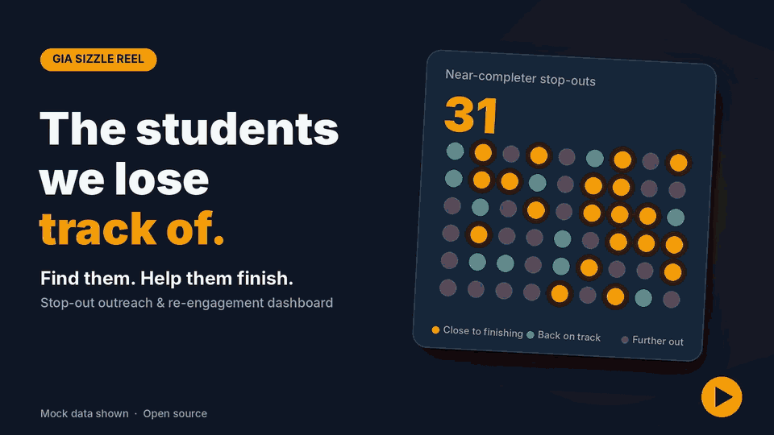
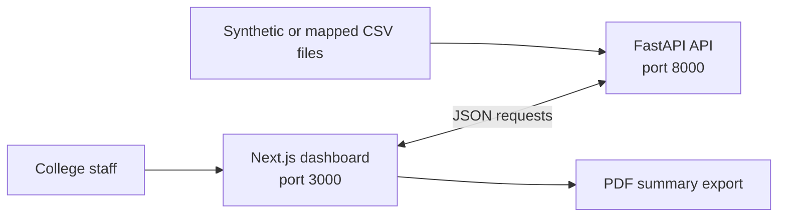

# Near Completers Dashboard

**Status: not maintained.** This is a prototype handed over as-is. It is not under active
development, and no support, security updates or bug fixes are promised. You are welcome to fork it
and adapt it. It has only been run on synthetic (made-up) data and has not been reviewed for
security, privacy or accessibility.

The dashboard helps community-college leaders, student-services teams, academic staff and financial-aid
staff find students who left a college close to finishing a credential. It summarizes how many may
be near completion and shows the courses or holds that may be keeping each person from returning.
The bundled demo data is synthetic; it does not describe real students or colleges.



Guides, SQL checks and AI skills for using and checking the dashboard are in the companion
[pdp-near-completer-finder-cookbooks](https://github.com/devcolor/pdp-near-completer-finder-cookbooks) repo.

## Architecture



## Prerequisites

Install Git, [mise](https://mise.jdx.dev), and [Bun](https://bun.sh). The repo's `playground/mise.toml`
pins Bun 1.4.3, Node.js 24, Python 3.14 and uv 0.13; `mise install` installs the pinned toolchain.
Docker is only needed if you choose PostgreSQL. The quick start below uses SQLite and does not need
Docker.

## Quick start with mock data

From a terminal with Git, mise and Bun installed:

See [Architecture](docs/architecture.md) for the shared ARF-to-normalized-model path, the separate
dashboard data path, where measures are computed, and the campus review process.

```bash
git clone https://github.com/devcolor/pdp-near-completer-finder.git
cd pdp-near-completer-finder/playground
mise trust && mise install
mise run db:choose sqlite
mise run db
mise run api:install
```

Start the API and web app in separate terminals, both from `playground/`:

```bash
mise run api:dev
```

```bash
mise run web:install && mise run web:dev
```

Open <http://localhost:3000>. The dashboard loads the bundled synthetic College 2 and Copper
Mountain data. The complete data provenance and replacement guidance is in
[`data/README.md`](data/README.md); where the dashboard reads its files and how uploads replace
them is in [docs/data-flow.md](docs/data-flow.md).

## Use your own PDP files

The dashboard does not read raw Postsecondary Data Partnership (PDP) files in `data/raw/` directly.
Prepare the four CSVs in the dashboard's required format, then follow the
[PDP replacement and privacy instructions](data/README.md).

The mock PDP files in `data/raw/` (synthetic, from Achieving the Dream):

| File | Rows | Columns | What it is |
| --- | ---: | ---: | --- |
| [pdp_cohort_data.csv](data/raw/pdp_cohort_data.csv) | 10,313 | 85 | One row per student. Dictionary: [cohort](data/dictionaries/arf_cohort_data_dictionary.md) |
| [pdp_course_data.csv](data/raw/pdp_course_data.csv) | 100,951 | 35 | One row per student per course per term. Dictionary: [course](data/dictionaries/arf_course_data_dictionary.md) |

## Environment variables, accounts and keys

No account or key is needed for the dashboard. The API and web app use local defaults; copy the
example files only if you need to override them. Keep local settings in git-ignored files and never
commit secrets or student records.

| Setting | Used by | Purpose |
| --- | --- | --- |
| `APP_ENV` | API | Selects development, staging or production settings. |
| `DATABASE_URL` | API | Database connection. SQLite is sufficient for the dashboard. |
| `CORS_ORIGINS` | API | Web app origins allowed to call the API. |
| `DASHBOARD_DATA_DIR` | API | Location of bundled institution CSV folders. |
| `DASHBOARD_UPLOAD_DIR` | API | Writable location for uploaded institution files. |
| `NEXT_PUBLIC_API_BASE_URL` | Web app | API base URL; defaults to `http://localhost:8000/api/v1` in development. |
| `ANTHROPIC_API_KEY` | API | Optional key for the separate Sandbox chat feature; not needed by the dashboard. |

The API's [`.env.example`](playground/server_application/.env.example) lists every API setting and
its default. The web app's [`.env.example`](playground/client_application/.env.example) lists its
optional overrides.

## Deploy options

- **Local machine:** suitable for an analyst or small team. Use SQLite and keep uploaded files on a
  machine approved by your college.
- **Vercel web app and API:** suitable for the synthetic demo. API uploads on Vercel are stored in
  `/tmp` and disappear when the service restarts. Follow the step-by-step guide in
  [docs/deploy.md](docs/deploy.md).
- **College-managed server or cloud:** needed for real student data. Add college-approved sign-in,
  access controls and durable protected storage before using real records.

## Known issues and limitations

The full list, including bugs, mock-data quirks and what only works locally, is in
[docs/known-issues.md](docs/known-issues.md).

- The app has only been tested with synthetic data; accuracy with real records is unverified.
- Stop-out, near-completer and exclusion rules are partly fixed in code and may not match another
  college's definitions.
- The dashboard expects semester terms; quarter calendars need code changes.
- There is no login or role-based access. Anyone who can open the app can see its data, including
  sensitive fields.
- Uploads are manual, and an upload can be rejected or produce incorrect counts until its mapping is
  checked. Verify sample records and totals before staff act on results.
- Credits remaining use current program requirements, which may differ from the catalog a student
  entered under.
- The dashboard has not been reviewed for security, privacy, accessibility or full-college scale.

## Credits

Built at the 2026 /dev/color Datathon by the GIA (Growing Inland Achievement) team. The raw mock PDP
file formats were provided by Achieving the Dream. See [`data/README.md`](data/README.md) for data
provenance and data-use terms.

## License

The code is licensed under the [MIT License](LICENSE). Data has separate terms; see
[`data/README.md`](data/README.md#data-use-terms).
