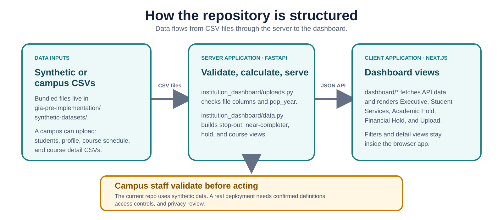
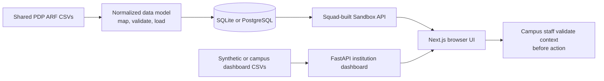

# Repository architecture

This repository has two related data paths. The shared PDP path maps Analysis-Ready File (ARF) CSVs
into the normalized data model. The institution dashboard path reads its synthetic institution CSVs
directly. It does not currently read the normalized database.

The dashboard is a local prototype built with synthetic data. A campus implementation would supply
validated CSV inputs, confirm the institutional definitions used by the server, and complete access
control and privacy review before using results to inform outreach or other action.

## Components

| Component | Location | Responsibility |
| --- | --- | --- |
| Shared PDP ARF CSVs | `data/raw/` | Source files mapped, validated, and loaded by the normalized data model. |
| Normalized data model | `normalized-data-model/` | Maps ARF columns, validates values, and loads reusable tables into SQLite or PostgreSQL. |
| Synthetic or campus dashboard CSVs | `gia-pre-implementation/synthetic-datasets/` | Provides the student, profile, course schedule, and course detail files used by the dashboard. |
| FastAPI server | `playground/server_application/` | Validates dashboard uploads, calculates views, and returns JSON. |
| Next.js client | `playground/client_application/` | Renders dashboard views and browser-based filters and detail views. |
| Campus staff | Outside the application | Confirms definitions, context, access controls, and appropriate next steps. |

## Where measures are computed

| Measure or output | Computed in | Notes |
| --- | --- | --- |
| Dashboard stop-outs, near-completers, holds, pathway, and course summaries | `playground/server_application/app/institution_dashboard/data.py` | Calculated from the dashboard CSVs after filters are applied. |
| Dashboard upload checks and diagnostic counts | `playground/server_application/app/institution_dashboard/uploads.py` | Validates the four expected dashboard files before the dashboard reads them. |
| Dashboard group rates and small-group suppression | `playground/server_application/app/institution_dashboard/data.py` | Applies the dashboard filters, calculates the numerator and denominator, and suppresses groups with fewer than 10 students. |
| Shared normalized tables | `normalized-data-model/src/` | Maps, validates, and loads source data; it does not calculate the current institution dashboard measures. |

The included datasets are synthetic. They are demonstrations, not findings about students or institutions.
