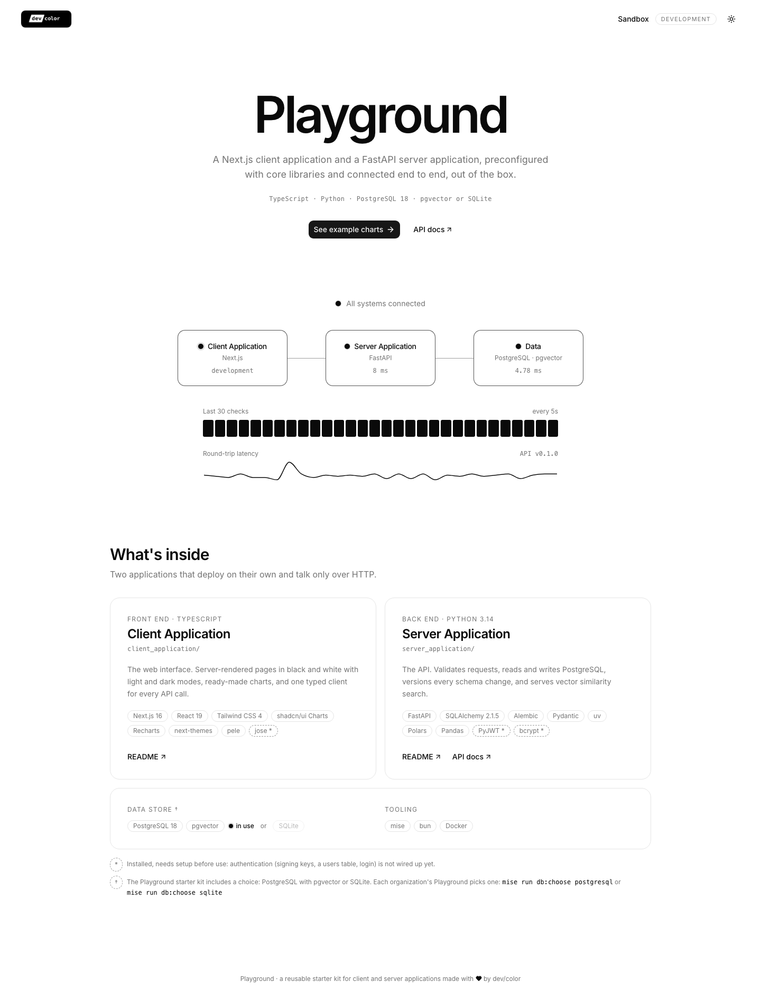
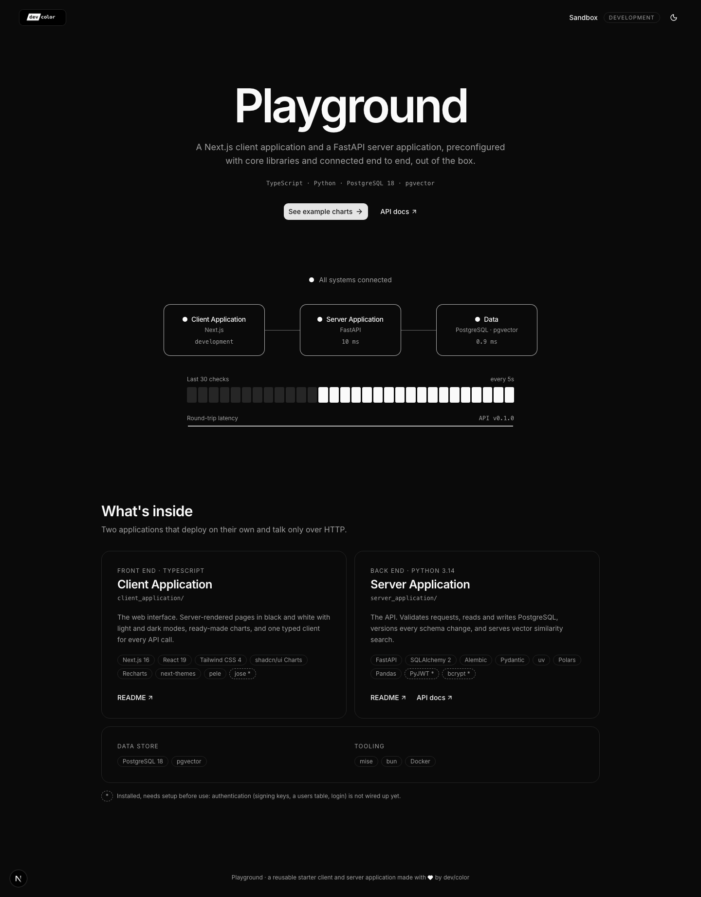
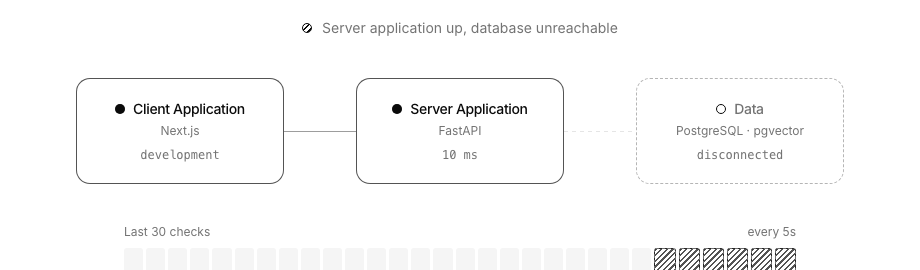
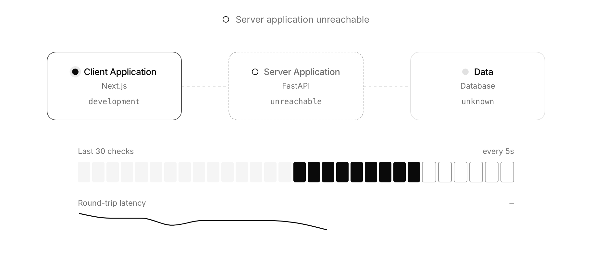
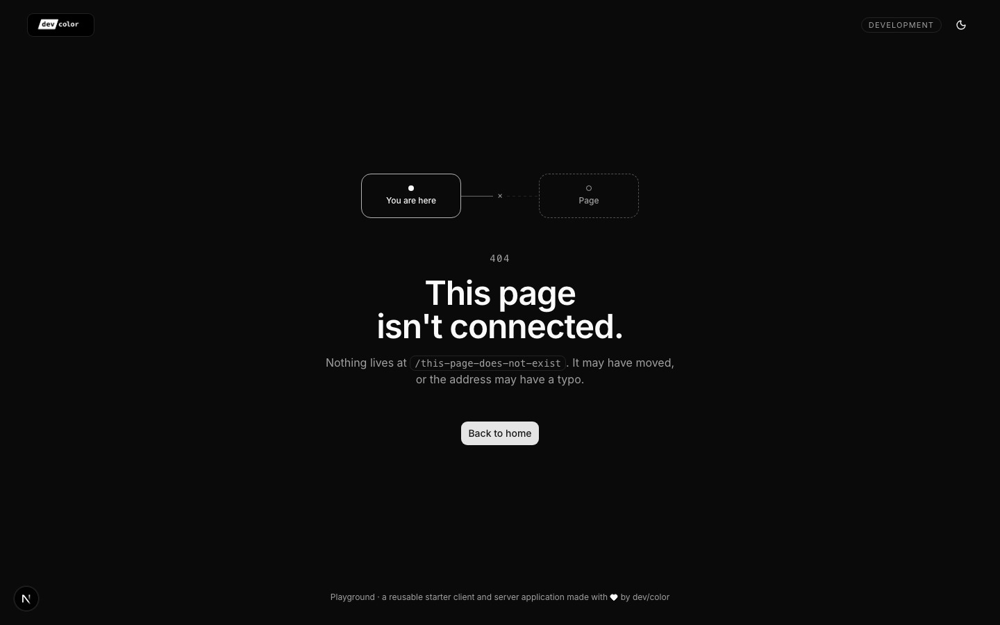

# Client Application

The Next.js front end for Playground; it gets all of its data from the
[Server Application](../server_application/README.md) and deploys on its own.

## Layout

```
src/
├── app/            # Pages: layout.tsx, page.tsx, not-found.tsx, error.tsx, globals.css
│   └── (app)/      # Every page except /; layout.tsx adds the app shell. The folder name isn't in the address
│       └── sandbox/    # One folder per sandbox page; layout.tsx adds the production 404
│           ├── page.tsx                                    # /sandbox: blank for now
│           ├── chart-examples/                             # /sandbox/chart-examples: page.tsx, charts.tsx, chart-config.ts, data.ts
│           ├── api-requests/                               # /sandbox/api-requests: the API explorer
│           ├── app-shell/                               # /sandbox/app-shell?shell=shell-2: the shell's two styles
│           ├── measures/                                   # /sandbox/measures: typed measure, cohort and grouping filters
│           ├── chat-ui/                                    # /sandbox/chat-ui: two chat layouts, with canned replies
│           ├── kpi-examples/                               # /sandbox/kpi-examples: the same four files
│           └── add-a-sandbox-page/                         # /sandbox/add-a-sandbox-page: the same four files
├── components/     # Render only. Shared: site header/footer, external link, section heading, load error
│   ├── landing/    # Live status, system diagram, tracker, sparkline, stack cards
│   ├── chat/       # The chat layouts: side panel, messenger
│   ├── sandbox/    # Building blocks for every sandbox page: chart card, charts, KPI cards, filters, API explorer
│   └── ui/         # shadcn/ui components (button, card, chart, skeleton)
├── content/        # Words and settings shown on pages
│   ├── brand.ts            # Name, tagline, logo, footer credit
│   ├── stack.ts            # "What's inside" cards
│   ├── chat-ui.ts          # The chat's wording and canned replies
│   ├── sandbox-examples.ts # The sandbox links in the left sidebar
│   ├── sandbox-how-to.ts   # The steps on the /sandbox/add-a-sandbox-page page
│   └── sandbox-requests.ts # The API explorer's preset requests
├── hooks/          # Browser state: use-health-monitor, use-api-resource, use-api-explorer
├── lib/            # Logic, with no markup. sandbox.ts holds ChartMeta, Kpi and the loaders every sandbox page shares
│   ├── env.ts                # Which environment we're in + its settings
│   ├── api-client.ts         # The single place that calls the API
│   ├── system-status.ts      # Turns health checks into states, diagram boxes, sparkline points
│   ├── connection-styles.ts  # Classes for each state (solid, striped, outlined)
│   ├── charts.ts             # Chart config, formatting (percent, counts), bar widths
│   ├── api-explorer.ts       # Sends a preset request and describes the result
│   ├── routes.ts, links.ts   # Page addresses and repository links
│   └── errors.ts, timing.ts, theme.ts, utils.ts
└── services/       # One file per API resource: health.ts
public/brand/       # Logo files (swap the logo in src/content/brand.ts, or set it to null)
docs/               # Screenshots used in the READMEs
```

**Rule of thumb:** `.tsx` files render. Calling the API, reading the environment, formatting, mapping
data and every other decision lives in `.ts` files in `lib/`, `services/`, `hooks/` and `content/`, so
it can be reused and tested without a page.

## How to run it locally

Start the database and Server Application first ([root README](../README.md#how-to-run-it-locally)), then:

```bash
mise run web:install && mise run web:dev     # http://localhost:3000
```

### Landing page: http://localhost:3000

A live check of the Server Application and database every 5 seconds, in light or dark mode.

<p>
  
  
</p>

### When something is down

The page says which part, and recovers on its own once it answers again.

| Database stopped (`mise run db`) | Server Application stopped (`mise run api:dev`) |
|---|---|
|  |  |

### Institution views: http://localhost:3000

The app opens on the executive view. Student services and academic are separate pages. They read the synthetic institution files through `/api/v1/dashboard`.

### 404 and error pages

Unknown addresses and unexpected errors get designed pages ([`not-found.tsx`](src/app/not-found.tsx),
[`error.tsx`](src/app/error.tsx)).



## Storybook: http://localhost:6006

Every component on its own, so you can build and check UI without running the app.

```bash
mise run web:storybook        # open Storybook
mise run web:test-storybook   # install Chromium, then render every story and run its checks
```

After installing project dependencies (`mise run web:install`), the test task installs Chromium and
its system dependencies automatically. The first run needs network access; Linux may request sudo.

- **Stories** sit next to their component: `button.tsx` → `button.stories.tsx`.
- **A story that checks behavior:** [`button.stories.tsx`](src/components/ui/button.stories.tsx)
  finds the control and checks its accessible name.
- **MCP addon:** `@storybook/addon-mcp` lets coding agents discover components and test the stories they
  write through the Vitest addon.
- **Shared setup** lives in [`.storybook/preview.tsx`](.storybook/preview.tsx): `globals.css`, the Inter
  font and the theme provider, the same as [`layout.tsx`](src/app/layout.tsx). Change one, change both.
  It also keeps sidebars inside their examples on Docs pages, so those stories render inline instead of
  in iframes.
- **Tests:** a story's `play` function runs as a test. `CssCheck` in
  [`button.stories.tsx`](src/components/ui/button.stories.tsx) fails if Tailwind stops loading.
- **AI agents:** while Storybook runs, it serves an MCP server at http://localhost:6006/mcp, set up for
  Claude Code in the repo's [`.mcp.json`](../../.mcp.json). Agents can read each component's props and
  stories and run story tests through it; see [`AGENTS.md`](AGENTS.md). To see what agents see, open
  http://localhost:6006/manifests/components.html.

## Environments

Next.js only knows development and production, so the app reads its own `NEXT_PUBLIC_APP_ENV`; defaults
live in [`src/lib/env.ts`](src/lib/env.ts) and overrides in a git-ignored `.env.local`
(copy [`.env.example`](.env.example)).

| Command | Environment | API base URL |
|---|---|---|
| `bun run dev` | `development` | `http://localhost:8000/api/v1` |
| `bun run build:staging` | `staging` | placeholder: `https://api.staging.example.com/api/v1` |
| `bun run build` | `production` | placeholder: `https://api.example.com/api/v1` |

## Commands (from the repo root)

| Command | What it does |
|---|---|
| `mise run web:install` | Install dependencies (`bun install`) |
| `mise run web:dev` | Run with hot reload on http://localhost:3000 |
| `mise run web:build` | Production build |
| `mise run web:build-staging` | Staging build |
| `mise run web:start` | Serve the last build |
| `mise run web:lint` | ESLint + TypeScript type check |
| `mise run web:storybook` | Run Storybook on http://localhost:6006 |
| `mise run web:test-storybook` | Run every story as a test (Vitest + Playwright) |
| `bunx shadcn@latest add <name>` | Add a shadcn/ui component |

## Libraries Included

Click a layer to see the libraries.

📦 *Available* = installed, not yet used.\
🔐 *Needs setup* = authentication pieces, intentionally not built.

<details open>
<summary><strong>Front End: TypeScript</strong></summary>

- [Next.js](https://nextjs.org/): Server-rendered React framework with route protection via its proxy.
- [Tailwind CSS](https://tailwindcss.com/): Utility-first styling with dark mode.
- [shadcn/ui Charts](https://ui.shadcn.com/charts): Donut, line and bar chart components.
- [Recharts](https://recharts.org/): SVG engine behind shadcn/ui Charts.
- [lucide-react](https://lucide.dev/): Icon set used by shadcn/ui (sun, moon, arrows).
- [next-themes](https://github.com/pacocoursey/next-themes): Light/dark mode that follows the OS, no flash on load.
- [pele](https://pele.run): 📦 Renders Mermaid diagrams as themed SVG.
- [jose](https://github.com/panva/jose): 📦 🔐 Verifies login tokens in the proxy; needs the API's signing key
  and a `proxy.ts`.

</details>

<details>
<summary><strong>Tooling</strong></summary>

- [bun](https://bun.sh): JavaScript runtime and package manager.
- [Storybook](https://storybook.js.org): Components in isolation, with stories that double as tests
  (see 👉🏾 [Storybook](#storybook-httplocalhost6006)).
- [mise](https://mise.jdx.dev): Installs and pins versions of almost any language or tool (e.g., Node,
  Python, Rust, Ruby, Go, Java and more). Here it pins bun and Node, and runs the `web:*` commands
  (see 👉🏾 [Commands](#commands-from-the-repo-root)).

</details>
