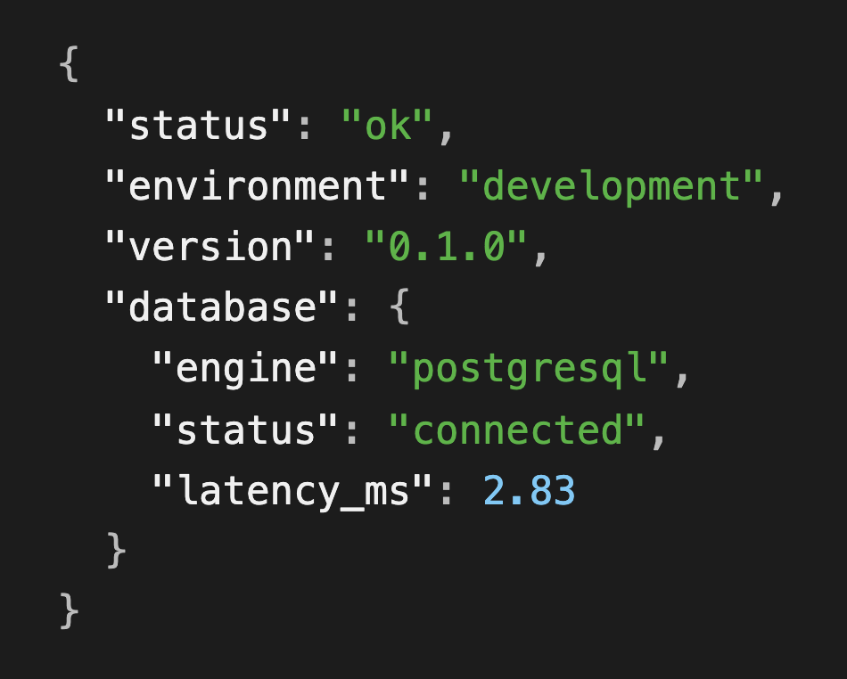
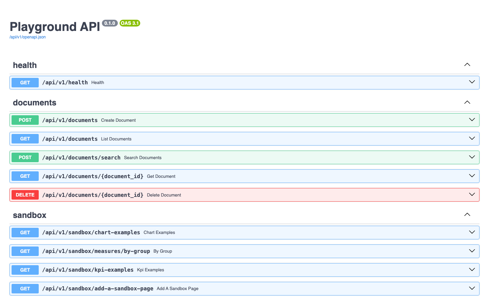

# Server Application

The FastAPI back end for Playground; it serves the [Client Application](../client_application/README.md)
and deploys on its own with just this folder and a `DATABASE_URL`.

## Layout

```
app/
├── main.py               # create_app(): middleware, routers, lifespan
├── core/config.py        # Settings, resolved from APP_ENV
├── core/errors.py        # One JSON shape for every error
├── db/base.py            # Base (naming convention), UUIDv7 + timestamp mixins
├── db/session.py         # Async engine, get_session dependency
├── db/types.py           # Embedding: pgvector on PostgreSQL (default), JSON on SQLite
├── models/               # SQLAlchemy models (import each in models/__init__.py)
├── schemas/              # Pydantic request/response models
├── services/             # Business logic; routes stay thin
├── api/dependencies.py   # SessionDep, EmbedderDep: shared by every route module
├── api/v1/routes/        # HTTP endpoints
└── sandbox/              # Mock-data endpoints, one folder per sandbox page
    ├── router.py         #   Mounts every sandbox page (off in production)
    ├── shared.py         #   ChartMeta, ChartResponse, Kpi: shared by every page
    ├── chart_examples/   #   /sandbox/chart-examples: the same three files
    ├── measures/         #   /sandbox/measures: routes.py, schemas.py, results.py
    ├── kpi_examples/     #   /sandbox/kpi-examples: the same three files
    └── add_a_sandbox_page/  #   /sandbox/add-a-sandbox-page: the same three files
alembic/                  # Migrations (config in pyproject.toml [tool.alembic])
tests/
```

## How to run it locally

From the repo root:

```bash
mise run db                                  # start the database first
mise run api:install && mise run api:dev     # http://localhost:8000
```

Health check: http://localhost:8000/api/v1/health



Every endpoint, ready to try: http://localhost:8000/docs



### Database migrations

`api:dev` applies pending migrations first, in local development only; staging and production migrate
as a deploy step. To skip them once:

```bash
AUTO_MIGRATE=false mise run api:dev
```

To skip them always, add this to a git-ignored `mise.local.toml` at the repo root:

```toml
[env]
AUTO_MIGRATE = "false"
```

## Environments

`APP_ENV` picks `development` (default), `staging` or `production`; settings then load from
`.env.<APP_ENV>` (committed defaults), `.env.<APP_ENV>.local` (git-ignored secrets) and real environment
variables, which always win. `postgres://` URLs from hosts are converted to the async driver.

Every setting the API reads is listed in [`.env.example`](.env.example) with its default. The
committed `.env.development`, `.env.staging` and `.env.production` hold only non-secret defaults;
put secrets in the matching `.env.<APP_ENV>.local` file or the hosting platform's environment variables.

### Deploying to Vercel

[`vercel.json`](vercel.json) deploys this folder as a FastAPI function. Its build copies the dashboard
CSVs from `gia-pre-implementation/synthetic-datasets` into this folder, because Vercel bundles only
the project's root directory. In the Vercel project:

- Set **Root Directory** to `playground/server_application` and turn on **Include files outside the
  root directory**.
- Set `APP_ENV=production`, `DATABASE_URL` (a `sqlite:////tmp/playground.db` URL works if you only
  need `/dashboard`), `CORS_ORIGINS` (for example `["https://your-web.vercel.app"]`) and
  `DASHBOARD_DATA_DIR=synthetic-datasets`.

The dashboard serves synthetic data only. Nothing it shows is a finding about real students or
colleges.

## Commands (from the repo root)

| Command | What it does |
|---|---|
| `mise run api:install` | Install dependencies (`uv sync`) |
| `mise run api:dev` | Apply pending migrations, then run with reload on http://localhost:8000 |
| `mise run api:test` | Run tests on the chosen database (`mise run db:choose`; PostgreSQL by default) |
| `mise run api:test-sqlite` | Run tests on SQLite, whichever database is chosen |
| `mise run api:lint` / `api:format` | Ruff lint / auto-fix + format |
| `mise run api:migrate` | Apply migrations |
| `mise run api:migrate-down` | Roll back one migration |
| `mise run api:migration "..."` | Autogenerate a migration from model changes |

## Endpoints

All under `/api/v1`; try them at http://localhost:8000/docs.

| Method | Path | What it does |
|---|---|---|
| `GET` | `/health` | Environment, version, database status (`503` if the database is down) |
| `POST` | `/documents` | Store text and its vector embedding |
| `GET` | `/documents` | List documents, newest first (`limit`, `offset`) |
| `GET` | `/documents/{id}` | Fetch one document |
| `DELETE` | `/documents/{id}` | Delete a document |
| `POST` | `/documents/search` | Most similar documents to a query, via pgvector cosine distance |
| `GET` | `/sandbox/chart-examples` | The example charts named in `?charts=` (repeat it for several), or every chart |
| `GET` | `/sandbox/kpi-examples` | The groups of KPI cards named in `?charts=` (repeat it for several), or all of them |
| `GET` | `/sandbox/measures/by-group` | One measure, cohort and student grouping (`measure`, `cohort`, `group_by`), with small groups suppressed |

### Errors

Every error has the same JSON shape ([`core/errors.py`](app/core/errors.py)):

```json
{"error": {"status": 404, "code": "not_found", "message": "No endpoint matches GET /api/v1/nope.",
           "path": "/api/v1/nope", "docs": "/docs"}}
```

| Situation | Status | `code` |
|---|---|---|
| Unknown endpoint (points to `/docs` outside production) | 404 | `not_found` |
| Missing resource, e.g. a deleted document | 404 | `not_found` |
| Wrong HTTP method | 405 | `method_not_allowed` |
| Invalid request body or query (lists each field in `details`) | 422 | `validation_error` |
| Unexpected server error (details stay in the server log) | 500 | `internal_error` |

## Libraries Included

Click a layer to see the libraries.

📦 *Available* = installed, not yet used.\
🔐 *Needs setup* = authentication pieces, intentionally not built.

<details open>
<summary><strong>Back End: Python</strong></summary>

- [FastAPI](https://fastapi.tiangolo.com/): Fast Python API framework.
- [uv](https://github.com/astral-sh/uv): Fast package installer, written in Rust.
- [SQLAlchemy 2.1.5](https://www.sqlalchemy.org/): Typed, async ORM for models and queries.
- [Alembic](https://alembic.sqlalchemy.org/): Versioned database migrations, upgrade or roll back.
- [Pydantic](https://docs.pydantic.dev/): Validates requests and serializes responses.
- [PyJWT](https://pyjwt.readthedocs.io/): 📦 🔐 Issues and verifies JWT tokens (`import jwt`); needs a
  signing key and login endpoints.
- [bcrypt](https://github.com/pyca/bcrypt): 📦 🔐 Salted password hashing (`bcrypt.hashpw` /
  `bcrypt.checkpw`); needs a users table and sign-up/login endpoints.

</details>

<details>
<summary><strong>Data Processing</strong></summary>

- [Polars](https://pola.rs/) / [Pandas](https://pandas.pydata.org/): 📦 Parse, clean and aggregate PDP AR
  files; Polars does the heavy lifting, [pyarrow](https://arrow.apache.org/docs/python/) converts between
  them (`df.to_pandas()`, `pl.from_pandas(df)`).

</details>

<details>
<summary><strong>Data Store</strong></summary>

- [PostgreSQL 18](https://www.postgresql.org/): Relational database with JSONB support.
- [pgvector](https://github.com/pgvector/pgvector): Stores embeddings and finds similar rows fast.

</details>

## Conventions

- **Alembic owns the schema.** The app never calls `create_all`. Review every autogenerated
  migration, then check that it applies, rolls back and applies again:

  ```bash
  mise run api:migrate && mise run api:migrate-down && mise run api:migrate
  ```
- **IDs are UUIDv7:** `uuid.uuid7()` in Python, `uuidv7()` in Postgres. Use `UUIDPrimaryKeyMixin`.
- **Serialization is Pydantic v2:** return schema objects from routes; no custom JSON response class.
- **Tests** use their own `playground_test` database, created and migrated automatically.
